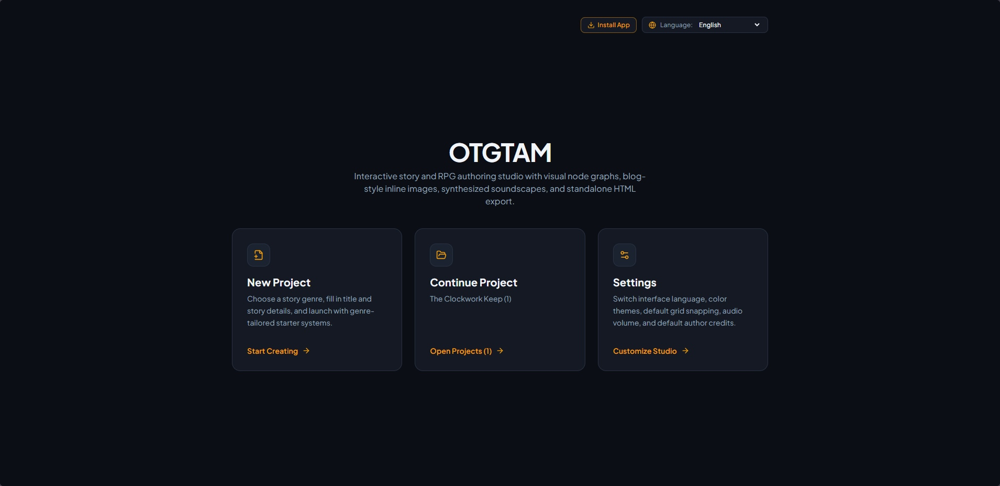
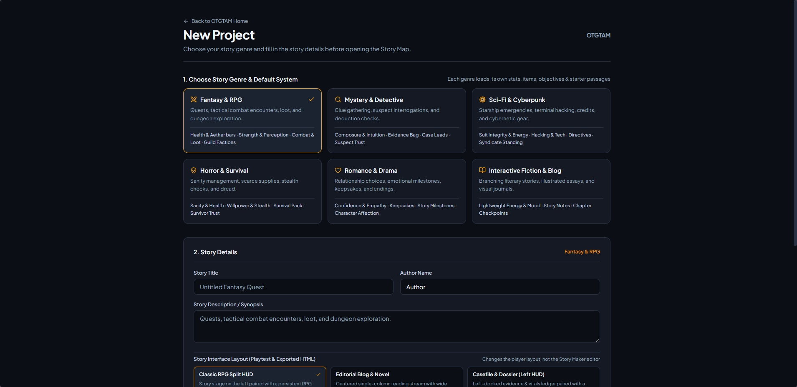
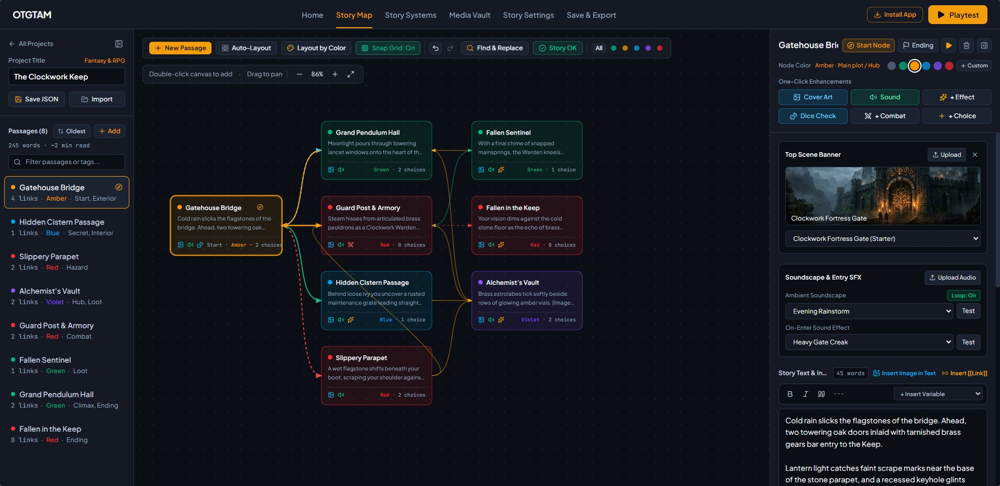
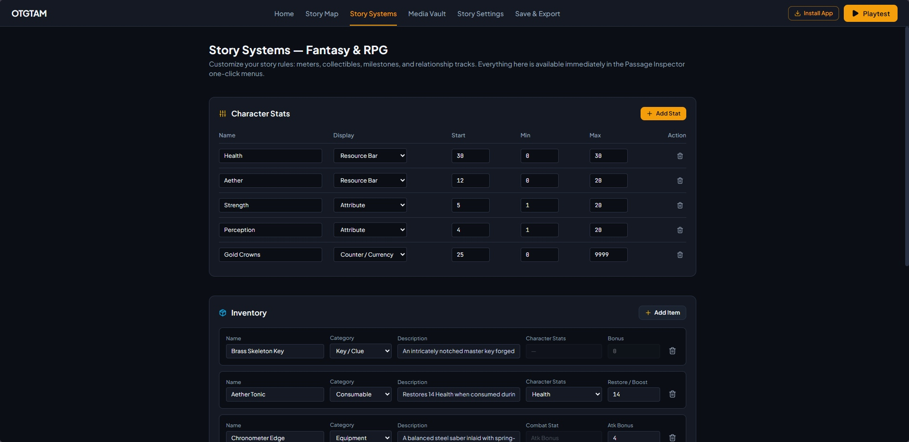
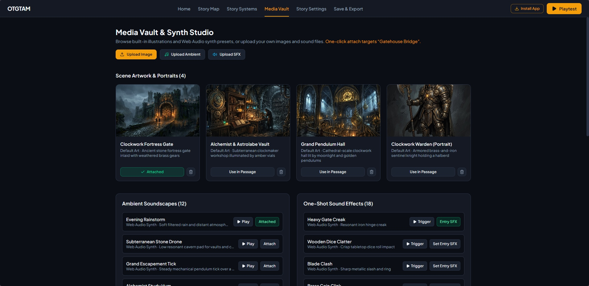

<div align="center">
  
  <h1>OTGTAM — Interactive Story &amp; RPG Studio</h1>
  <p>
    A visual, offline-capable interactive fiction and RPG authoring studio with branching story maps,
    built-in dice checks, inventory, quests, turn-based combat, synthesized audio, and single-file HTML export.
  </p>
  <p>
    <strong>8 Languages</strong> · <strong>6 Genre Templates</strong> · <strong>Installable PWA</strong> · <strong>Zero Backend Required</strong>
  </p>
</div>

---

## Screenshots

### 1. Welcome & Studio Hub


### 2. New Project & Multi-Genre Setup


### 3. Visual Branching Story Map & Passage Inspector


### 4. Story Systems (Stats, Inventory, Quests & Factions)


### 5. Media Vault & Web Audio Synth Studio


---

## Features

### Visual Authoring & Story Mapping
- **Infinite Node Canvas**: Pan, zoom, drag, and connect story passages with smooth Bezier branch links and snap-to-grid alignment.
- **Smart Organization**: One-click **Auto-Layout** by story depth or color tags, custom passage colors, and collapsible sidebars.
- **Story Validator**: Automatically detects missing start nodes, broken choice links, unreachable passages, dead ends, and empty scenes.
- **Writer Productivity Tools**: Full project **Undo / Redo** (`Ctrl+Z` / `Ctrl+Shift+Z`), **Global Find & Replace** (`Ctrl+H`), inline `[[Passage]]` link detection, and live word count & reading-time stats.

### Multi-Genre RPG & Narrative Systems
- **6 Genre Starters**: Start instantly with tailored templates for **Fantasy & RPG**, **Mystery & Detective**, **Sci-Fi & Cyberpunk**, **Horror & Survival**, **Romance & Drama**, or **Interactive Fiction & Blog**.
- **Complete State Engine**: Track custom **Stats**, **Inventory Items**, **Quests**, **Faction Reputation**, and **Story Flags**.
- **Interactive Encounters**: Add **Dice Skill Checks** (stat modifier + DC + success/failure branches), **Turn-Based Combat Encounters**, and conditional choices (`Has item`, stat comparisons, quest states, flags).
- **Fast Choice Authoring**: Reorder choices (`Up`/`Down`) and apply quick effect presets (`+ Stat`, `+ Item`, `+ Flag`) directly in the inspector.

### Media, Audio & Typography
- **Media Vault & Auto-Compression**: Upload cover art, inline scene illustrations, and enemy portraits with automatic client-side WebP compression (configurable in Settings).
- **Built-In Web Audio Synthesizer**: Attach procedural ambient soundscapes and entry SFX to passages—embedded directly into exported stories with zero external audio files required.
- **5 Reader Layouts & Custom Themes**: Choose from *Classic RPG Split HUD*, *Editorial Blog & Novel*, *Casefile & Dossier*, *Sci-Fi Console HUD*, and *Cinematic Theater*, paired with 5 font families, 4 font sizes, 5 built-in palettes, custom theme builder, and an in-reader **Light / Dark / Default** mode switcher.

### Export, Localization & Offline PWA
- **Single-File HTML Export**: Package your entire interactive story—prose, images, synthesized audio, themes, and RPG HUD—into one standalone `.html` file players can open offline in any browser or upload to itch.io / Netlify / GitHub Pages.
- **JSON Project Backup**: Export and import `.otgtam.json` files to back up drafts or collaborate across devices.
- **8 Languages**: Full UI and reader/export localization in **English**, **Bahasa Indonesia**, **Español**, **Français**, **日本語**, **한국어**, **简体中文**, and **Deutsch**.
- **Offline-First PWA**: Persists multi-project libraries in browser **IndexedDB** (with `localStorage` fallback), caches app assets with a Workbox service worker, displays offline status, and installs as a standalone desktop or mobile app.

---

## Tech Stack

- **Frontend**: React 19, TypeScript, Tailwind CSS v4, Lucide Icons, Motion
- **Build & PWA**: Vite, `vite-plugin-pwa` (Workbox service worker & Web App Manifest)
- **Storage & Media**: IndexedDB, Canvas WebP image compression, Web Audio API

---

## Getting Started

### Prerequisites
- **Node.js** 18+ and **npm**

### Local Development
```bash
# Install dependencies
npm install

# Start the development server on http://localhost:3000
npm run dev
```

### Production Build & Type Check
```bash
# Run TypeScript type checking
npm run lint

# Build production bundle (outputs to dist/)
npm run build

# Preview production build locally
npm run preview
```

---

## Installing as a Desktop / Mobile App (PWA)

1. Open your deployed site (or local preview URL) in its own browser tab.
2. Click **Install App** in the Home header, top workspace bar, or **Settings → App Installation & Offline Mode** (or click your browser's address-bar install icon).
3. **On iOS Safari**: Tap **Share → Add to Home Screen**.

Once installed, OTGTAM runs in a standalone window and works offline using locally cached assets and IndexedDB storage.

---

## Deploying to Static Hosting

OTGTAM is a 100% client-side application and can be deployed for free on **Vercel**, **Netlify**, **Cloudflare Pages**, or **GitHub Pages**:

- **Build command**: `npm run build`
- **Output directory**: `dist`

---

## Project Structure

```text
├── docs/screenshots/      # README preview screenshots
├── public/                # PWA icons (SVG, PNG, maskable, Apple Touch Icon)
├── src/
│   ├── audio/             # Procedural Web Audio soundscape & SFX synthesizer
│   ├── components/        # Studio workspace, canvas, inspector, playtest & export UI
│   ├── data/              # Genre templates, starter story, themes & layouts
│   ├── engine/            # RPG simulation, story validator, HTML exporter & text stats
│   ├── hooks/             # PWA install prompt & online/offline status hooks
│   ├── i18n/              # Language context & 8-language translation bundles
│   ├── media/             # Client-side image auto-compression utilities
│   ├── storage/           # IndexedDB persistence & browser quota estimation
│   └── types/             # TypeScript story, passage, RPG & settings types
├── index.html
├── package.json
└── vite.config.ts
```

---

## License

Add your preferred license (e.g., `MIT`) to the repository if you plan to accept contributions or distribute forks.
